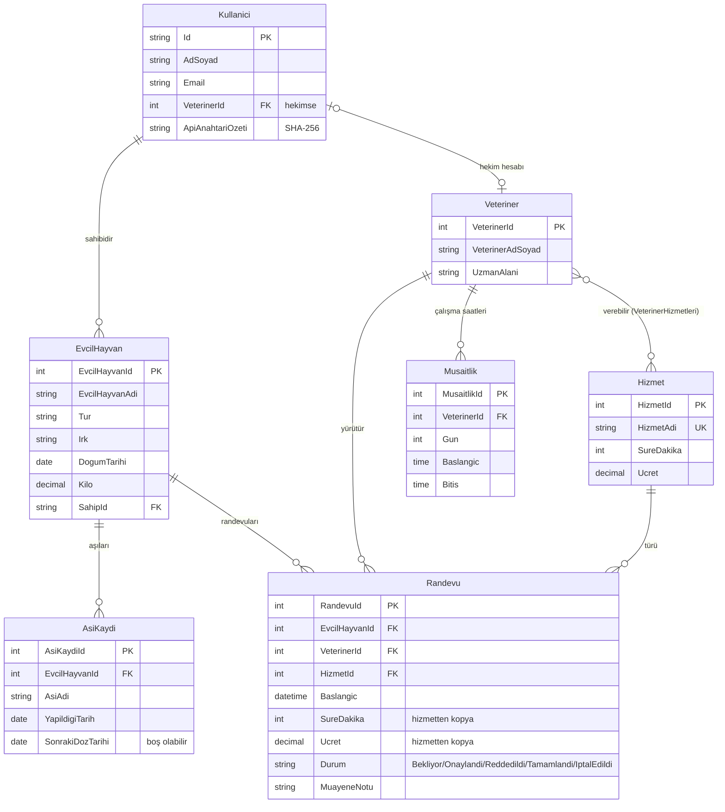

# Veteriner Kliniği Randevu ve Hasta Takip Sistemi

**Öğrenci No:** G211210566  
**Ad Soyad:** Mahmoud Almohamad Dibo  
**Ders Grubu:** 2.A  
**GitHub:** https://github.com/MAHMOUDDIBO/VetKlinik  

---

## 1. Proje Hakkında

ASP.NET Core MVC (.NET 10) ile geliştirilen bu uygulama bir veteriner kliniğinin günlük işlerini yönetir:

- Kliniğin **hizmetleri** (muayene, aşı, kısırlaştırma, diş temizliği, tıraş ve bakım) süre ve ücretleriyle tanımlanır.
- **Veteriner hekimler**, uzmanlık alanları, verebildikleri hizmetler ve haftalık **çalışma saatleri** tutulur.
- **Hayvan sahipleri** üye olur, birden fazla **evcil hayvan** kaydeder; her hayvanın **aşı geçmişi** ve **yaklaşan aşıları** izlenir.
- Üye; hayvanını, hizmeti ve günü seçer, sistem o gün **boş olan hekim ve saatleri** listeler. Hekimin çalışma saati,
  önceki randevuları ve **hizmetin süresi** çakışma hesabına dahildir.
- Randevu **"Bekliyor"** durumunda oluşur; **admin veya ilgili hekim** onaylar ya da reddeder. Randevu sonrası hekim
  **muayene notu** girer.
- **REST API** (DTO + LINQ) ve bir yapay zekâ asistanının çağırabileceği **MCP sunucusu** aynı servis katmanını kullanır.

Tek klinik üzerinde çalışır; kliniğin çalışma saatleri, hekimlerin müsaitlik aralıklarıyla tanımlanır.

### Kullanılan teknolojiler

| Katman | Teknoloji |
|---|---|
| Web | ASP.NET Core MVC (.NET 10), Razor, Tag Helper'lar |
| Veri | Entity Framework Core 10 (Code First, Migration), SQLite, LINQ |
| Kimlik | ASP.NET Core Identity (3 rol), çerez + kişisel erişim anahtarı (Bearer) |
| Yapay zekâ | ModelContextProtocol.AspNetCore (MCP C# SDK) |
| Arayüz | Bootstrap 5, jQuery, jQuery Validation (Türkçe sayı biçimi) |

---

## 2. Mimari

```
Tarayıcı ─┐
API istemcisi ─┼──►  MVC Controller'ları / API Controller'ları / MCP Araçları
MCP istemcisi ─┘                    │
                                    ▼
                    Servis katmanı (iş kuralları TEK yerde)
            HizmetServisi · VeterinerServisi · EvcilHayvanServisi
            AsiServisi · RandevuServisi · RaporServisi
                                    │
                                    ▼
                   UygulamaDbContext (EF Core) ──► SQLite
```

- Controller'lar iş kuralı bilmez; servise sorar, sonucu view'a / JSON'a / MCP cevabına çevirir.
- Her servis metodu **"kim istiyor?"** bilgisini (`AktifKullanici`) alır. Sahiplik kontrolü serviste yapılır;
  bu yüzden üye, adres çubuğunda id değiştirerek başka bir üyenin hayvanını veya randevusunu **göremez** (404).
- Formlar entity değil **ViewModel** bağlar (over-posting koruması). Tüm POST'lar `[ValidateAntiForgeryToken]` taşır
  ve **PRG** (Post-Redirect-Get) kalıbını izler.
- Doğrulama hem **istemcide** (jQuery Validation) hem **sunucuda** (DataAnnotations, `IValidatableObject`,
  servisteki iş kuralları → `ModelState.AddModelError`) yapılır.

### Klasör yapısı

| Klasör | İçerik |
|---|---|
| `Models` | Entity'ler: Kullanici, Hizmet, Veteriner, Musaitlik, EvcilHayvan, AsiKaydi, Randevu |
| `Data` | `UygulamaDbContext` (Fluent API ilişkileri), `VeriTohumlayici` (roller, admin, örnek veri) |
| `Services` | İş kuralları — MVC, API ve MCP'nin ortak katmanı |
| `Guvenlik` | Roller, `AktifKullanici`, claim fabrikası, Bearer anahtar doğrulayıcı |
| `ViewModels` | Form modelleri ve doğrulama kuralları |
| `Dtos` | API'nin döndürdüğü veri sözleşmeleri |
| `Controllers` / `Controllers/Api` | MVC ve REST API uçları |
| `Mcp` | MCP araçları (`KlinikAraclari`) |

---

## 3. Veritabanı Modeli (ER Diyagramı)



**Tasarım kararları**

- `Randevu.SureDakika` ve `Randevu.Ucret` randevu anında hizmetten **kopyalanır**: hizmetin fiyatı sonradan değişse
  bile geçmiş randevunun ücreti ve ciro raporu değişmez.
- Randevusu olan hekim veya hizmet silinemez (`DeleteBehavior.Restrict`); evcil hayvan silinince aşı ve randevu
  geçmişi de silinir (`Cascade`).
- Identity tabloları (AspNetUsers, AspNetRoles, …) aynı veritabanındadır.

---

## 4. Roller ve Yetkiler

| Rol | Yapabildikleri |
|---|---|
| **Admin** | Hizmet ve hekim CRUD, çalışma saatleri, tüm randevular (onay/ret/silme), tüm hastalar, panel ve rapor, kullanıcılar |
| **Veteriner** | Kendi randevularını onaylar/reddeder, muayene notu girer, hastaları görür, aşı kaydı ekler/düzenler/siler |
| **Üye** | Üye olur, kendi hayvanlarını ekler/düzenler/siler, randevu alır/değiştirir/iptal eder, yalnızca kendi verilerini görür |

### Demo hesaplar (ilk açılışta otomatik oluşur)

| Rol | E-posta | Şifre |
|---|---|---|
| Admin | `G211210566@sakarya.edu.tr` | `sau` |
| Veteriner | `ayse.kaya@vetklinik.com` | `sau` |
| Veteriner | `mehmet.demir@vetklinik.com` | `sau` |
| Üye | `ali@ornek.com` (Pamuk, Karabaş) | `sau` |
| Üye | `elif@ornek.com` (Maviş) | `sau` |

---

## 5. Randevu Kuralları

Bir randevu talebi şu sırayla kontrol edilir (`RandevuServisi.CakismaNedeniAsync`):

1. Geçmiş bir zamana randevu alınamaz.
2. Seçilen hekim bu hizmeti verebiliyor olmalı.
3. Randevu, **hizmet süresi dahil**, hekimin o günkü çalışma aralığının içinde kalmalı.
4. Hekimin aynı gün yer tutan (Bekliyor / Onaylandı / Tamamlandı) bir randevusuyla çakışmamalı.
   İki aralık `[a1, a2)` ve `[b1, b2)` için çakışma koşulu: `a1 < b2 && b1 < a2`.
5. Aynı hayvanın aynı saatte başka randevusu olmamalı.

Uygun değilse kullanıcıya **nedeni** gösterilir (ör. *"Ayşe Kaya 10:00–10:30 arasında başka bir randevuda."*).
Randevu Al sayfası, boş saatleri REST API'den çektiği için kullanıcı normalde çakışan bir saati seçemez; sunucu
yine de her talebi yeniden kontrol eder.

Durum akışı: `Bekliyor → Onaylandı → Tamamlandı (muayene notu)` · `Bekliyor → Reddedildi` · `Bekliyor/Onaylandı → İptal Edildi (sahip)`

---

## 6. REST API

Tüm uçlar **DTO** döndürür (entity değil) ve doğru HTTP durum kodlarını kullanır.
Kimlik gerektiren uçlar tarayıcı çerezini **veya** `Authorization: Bearer <anahtar>` başlığını kabul eder.
Veri yazan `POST /api/randevular` yalnızca Bearer anahtarı kabul eder (çerezle yazmak CSRF riski taşır).
Anahtar, giriş yaptıktan sonra **Profil** sayfasından oluşturulur.

| Metot | Uç | Açıklama | Kodlar |
|---|---|---|---|
| GET | `/api/hizmetler` | Tüm hizmetler | 200 |
| GET | `/api/hizmetler/{id}` | Tek hizmet | 200, 404 |
| GET | `/api/veterinerler` | Tüm hekimler (hizmetler, çalışma saatleri) | 200 |
| GET | `/api/veterinerler?hizmetId=3` | **LINQ filtresi:** o hizmeti verebilen hekimler | 200 |
| GET | `/api/veterinerler/{id}` | Tek hekim | 200, 404 |
| GET | `/api/veterinerler/uygun?hizmetId=1&tarih=2026-11-23` | **Belirli tarihte, seçilen hizmet için uygun hekimler ve boş saatler** | 200, 400, 404 |
| GET | `/api/evcilhayvanlar` 🔒 | Kullanıcının hayvanları | 200, 401 |
| GET | `/api/evcilhayvanlar/{id}/asilar` 🔒 | **Aşı geçmişi ve yaklaşan aşılar** | 200, 401, 404 |
| GET | `/api/randevular` 🔒 | Kullanıcının randevuları | 200, 401 |
| GET | `/api/randevular/{id}` 🔒 | Tek randevu | 200, 401, 404 |
| POST | `/api/randevular` 🔑 | Randevu oluştur ("Bekliyor") | **201**, 400, 401, 404 |
| GET | `/api/raporlar/hizmet?baslangic=&bitis=` 🔒 Admin | **Hizmet türüne göre randevu sayısı ve ciro** | 200, 400, 401, 403 |

### Örnek istek / cevap

```http
GET /api/veterinerler/uygun?hizmetId=1&tarih=2026-11-23
```

```json
{
  "hizmetId": 1,
  "hizmetAdi": "Muayene",
  "sureDakika": 30,
  "tarih": "2026-11-23",
  "hekimler": [
    { "veterinerId": 1, "adSoyad": "Ayşe Kaya", "uzmanAlani": "Küçük Hayvan",
      "saatler": ["09:00", "09:15", "09:30", "10:30", "10:45"] },
    { "veterinerId": 3, "adSoyad": "Zeynep Arslan", "uzmanAlani": "Dermatoloji",
      "saatler": ["13:00", "13:15", "13:30"] }
  ]
}
```

```http
POST /api/randevular
Authorization: Bearer vk_...
Content-Type: application/json

{ "evcilHayvanId": 1, "hizmetId": 1, "veterinerId": 1, "baslangic": "2026-11-23T10:00:00" }
```

```http
HTTP/1.1 400 Bad Request
{ "hata": "Ayşe Kaya 10:00–10:15 arasında başka bir randevuda." }
```

> 📸 _Ekran görüntüsü: Postman / tarayıcıda bir API isteği ve cevabı buraya eklenecek._

---

## 7. Yapay Zekâ Entegrasyonu — MCP Sunucusu

Uygulama, `/mcp` adresinde **Streamable HTTP** üzerinden çalışan bir MCP sunucusu içerir
(`ModelContextProtocol.AspNetCore`). Araçlar, MVC ve REST API ile **aynı servisleri** çağırır; iş kuralı tekrar yazılmaz.

| Araç | Tür | Açıklama |
|---|---|---|
| `hizmetler` | okur | Hizmetler, süreleri ve ücretleri |
| `hayvanlarim` | okur | Kullanıcının evcil hayvanları |
| `uygun_saatler(hizmetId, tarih)` | okur | O gün boş olan hekim ve saatler |
| `asi_takvimi(hayvanAdi)` | okur | Geçmiş ve yaklaşan aşılar |
| `randevularim` | okur | Kullanıcının randevuları |
| `randevu_olustur(hayvanAdi, hizmetId, veterinerId, tarih, saat)` | **yazar** | "Bekliyor" durumunda randevu; çakışma varsa nedenini açıklar |

**Yetkilendirme:** `/mcp` ucu `Authorization: Bearer <kişisel anahtar>` ister; anahtarsız istek **401** alır.
Anahtar Profil sayfasında üretilir, kullanıcıya bir kez gösterilir, veritabanında yalnızca SHA-256 özeti tutulur.
Araçlar kullanıcıyı bu anahtardan tanır ve **yalnızca o kullanıcının verisini** döndürür.

### MCP Inspector ile test

1. Uygulamayı **http** profiliyle çalıştırın; adres `Properties/launchSettings.json` içindedir (ör. `http://localhost:5080`).
2. `ali@ornek.com / sau` ile giriş yapın → **Profil → Anahtar oluştur** → anahtarı kopyalayın.
3. Terminal: `npx @modelcontextprotocol/inspector`
4. Transport: **Streamable HTTP**, URL: `http://localhost:5080/mcp`,
   Authentication → Header: `Authorization`, Value: `Bearer vk_...` → **Connect**.
5. **Tools → List Tools** → `asi_takvimi` → `hayvanAdi = Pamuk` → **Run Tool**.

### Claude Desktop / VS Code yapılandırması (örnek)

```json
{
  "servers": {
    "vetklinik": {
      "type": "http",
      "url": "http://localhost:5080/mcp",
      "headers": { "Authorization": "Bearer vk_..." }
    }
  }
}
```

> 📸 _Ekran görüntüsü: MCP Inspector'da `asi_takvimi` ve `randevu_olustur` çağrıları buraya eklenecek._

---

## 8. Ekran Görüntüleri

> 📸 _Ana sayfa · Randevu Al (uygun saatler) · Hayvan detayı (aşı takvimi) · Hekim onay ekranı · Yönetim paneli ve rapor_

---

## 9. Kurulum

Gereksinim: Visual Studio 2026 (veya .NET 10 SDK).

```bash
git clone https://github.com/MAHMOUDDIBO/VetKlinik.git
```

Package Manager Console:

```powershell
Update-Database
```

veya yalnızca uygulamayı çalıştırın: açılışta bekleyen migration'lar uygulanır, roller, admin hesabı ve örnek veriler
oluşturulur. Veritabanı (`vetklinik.db`, SQLite) proje klasöründe oluşur ve depoya eklenmez.
Bağlantı dizesinde parola yoktur; depoda gizli anahtar bulunmaz.
